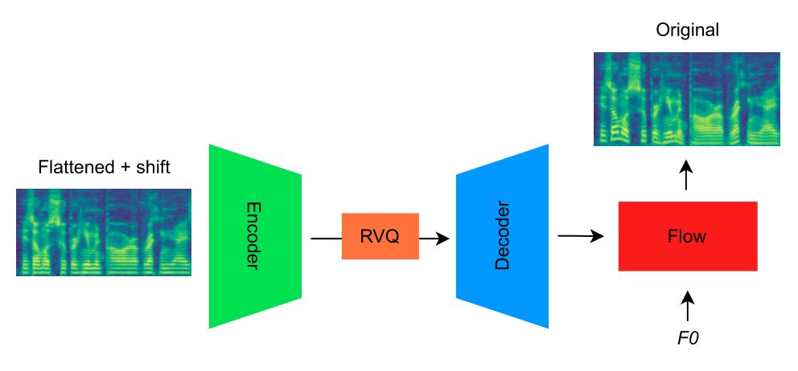

# 🌸 PitchFlower

<p align="left">
  <a href="https://arxiv.org/abs/2510.25566">
    
  </a>
  <a href="https://huggingface.co/diegotg343/PitchFlower">
    
  </a>
</p>


Official implementation of the paper *PitchFlower: A flow-based neural audio codec with pitch controllability*.

This repository contains the code to do training and inference with our model. A pretrained checkpoint is also available on 🤗.

## 🧠 Overview

PitchFlower achieves pitch controllability by means of a perturbation strategy. During inference, pitch information is removed by applying a random flattening and shifting operation. The model is trained with a reconstruction task, providing pitch information explicitly.  

<p align="center">
  
</p>

We use an autoencoder with an RVQ bottleneck and a flow-based decoder to produce high-quality audio. More details can be found in the paper.

## 📦 Installation

#### 1. Create and activate a new Python environment 
```bash
conda create -n pitchflower python=3.10

conda activate pitchflower
```

#### 2. Install the project, either in inference-only or training mode
```bash
# Inference-only
pip install .

# Training
pip install .[train]
```

## 🚀 Usage

### 🎤 Inference

The notebook `f0_control.ipynb` shows how to use PitchFlower to perform pitch manipulation. Change the path there to point to your checkpoint or the pretrained model downloaded from [🤗](https://huggingface.co/diegotg343/PitchFlower). 

We only show pitch transposition for simplicity, but feel free to use PitchFlower's ability to modify pitch in any way you want!


### ⚙️ Training

Installing the training mode gives you access to three CLI commands: `preprocess_data`, `pitchflower` and `save_pretrained`. They will allow you to prepare your data, perform training, and save an inference-friendly checkpoint of PitchFlower.

#### 1. Data preprocessing

Use the `preprocess_data` command to perform the pitch perturbation strategy required to train PitchFlower. Here's an example of how to use it:

```bash
preprocess_data /data/train_audios /data/train_prep --csv data/train.csv --workers 10
```

This command will find all files with an audio extension inside the `/data/train_audios` folder and do the preprocessing. Resulting perturbed audios and F0 contours will be saved at `/data/train_prep`. A csv file with all the important paths will be created at `data/train.csv`. We recommend you set `--workers` to an appropriate value to speed up computation. 

Additionally, you can use the `--strength` argument to change the strength of the pitch perturbation. The default value is 5 semitones.

#### 2. PitchFlower training

Create a config file with the training parameters. You can use as template the config given with the repository. The main things to change to have a working version are:

- Training/validation files: put the paths of your .csv files produces during preprocessing at the entries `train_path` and `val_path` of the config.

- Checkpoint/log path: add the paths where the checkpoint and logs will be saved during training. 

Once you have done this, run the training with the following command
```bash
pitchflower fit --config configs/config.yaml
```
You can go to the logs folder and check how the training is going with TensorBoard.
#### 3. Saving a pretrained model

After training, you can save only the necessary components to perform inference. Simply use the `save_pretrained` command pointing at the checkpoint and the folder where you want to save it

```bash
save_pretrained /data/checkpoints/last.ckpt /data/inference_checkpoint
```

You can then use your model in the same way as in the notebook!

## 🙌 Acknowledgements

We'd like to acknowledge the repositories from which we draw inspiration and parts of the code

- Vocos: https://github.com/gemelo-ai/vocos
- WavTokenizer: https://github.com/jishengpeng/WavTokenizer
- Encodec: https://github.com/facebookresearch/encodec

This work has been done in the [Analysis/Synthesis team of the STMS laboratory](https://www.stms-lab.fr/team/analyse-et-synthese-des-sons/) at IRCAM. It has been funded by the [ANR project EVA](https://anr.fr/Project-ANR-23-CE23-0018).

## 📫 Contact

For questions or collaboration opportunities, feel free to reach out: dtorres@ircam.fr

## 🧩 Citation

```bibtex
@misc{pitchflower,
      title={PitchFlower: A flow-based neural audio codec with pitch controllability}, 
      author={Diego Torres and Axel Roebel and Nicolas Obin},
      year={2025},
      eprint={2510.25566},
      archivePrefix={arXiv},
      url={https://arxiv.org/abs/2510.25566}, 
}
```

## 📜 License

This project is licensed under the [CC BY-NC-SA 4.0](https://creativecommons.org/licenses/by-nc-sa/4.0/) license.